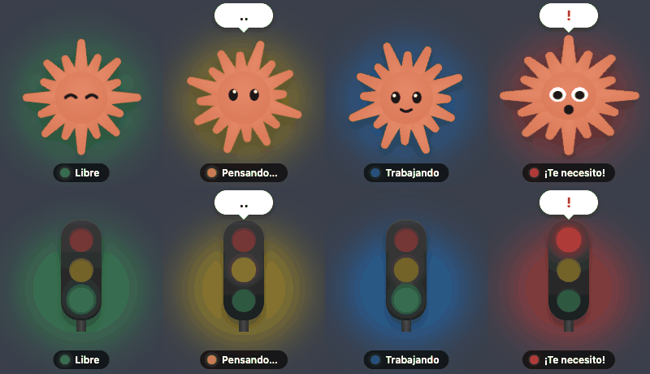

<div align="center">

# 🟢🟡🔵🔴 Agentling

**A tiny always-on-top desktop pet that shows what your AI coding agent is doing.**<br>
Idle, thinking, working, or waiting for you — visible even when the agent's window is minimized or on another desktop.

[](https://github.com/mariovasco24/agentling/actions/workflows/ci.yml)
[](https://github.com/mariovasco24/agentling/releases/latest)
[](LICENSE)



[Español](README.es.md)

</div>

---

## ⚡ Quick start

Open a terminal and run:

```bash
git clone https://github.com/mariovasco24/agentling.git && cd agentling && npm run setup && npm start
```

That's it. The pet appears in the bottom-right corner of your screen. Restart any running Claude Code session so it starts reporting its status.

> **Missing Git or Node.js?** See [Requirements](#-requirements) — it's one command per system.

---

## 📖 Table of contents

1. [What it does](#-what-it-does)
2. [Requirements](#-requirements)
3. [Compatibility](#-compatibility)
4. [Installation, step by step](#-installation-step-by-step)
5. [Using Agentling](#-using-agentling)
6. [Supported agents](#-supported-agents)
7. [Update and uninstall](#-update-and-uninstall)
8. [Commands reference](#-commands-reference)
9. [Themes](#-themes)
10. [Configuration](#-configuration)
11. [How it works, privacy and security](#-how-it-works-privacy-and-security)
12. [Troubleshooting](#-troubleshooting)
13. [FAQ](#-faq)
14. [Development and contributing](#-development-and-contributing)
15. [Versioning and license](#-versioning-and-license)

---

## 🎯 What it does

Agentling is a small floating character that works like a traffic light for your AI agent:

| Light | State | Meaning | Extra |
|:---:|---|---|---|
| 🟢 | **Idle** | The agent is done; nothing is running | |
| 🟡 | **Thinking** | You sent a prompt and the agent is reasoning | animated "…" bubble |
| 🔵 | **Working** | The agent is running tools (editing files, running commands…) | |
| 🔴 | **Needs you** | The agent is waiting for a permission or an answer | "!" bubble + a sound |

- Stays **on top of every window**, on all desktops and over full-screen apps.
- **Drag it anywhere**; it remembers its position.
- With several sessions open (even from different agents) it shows **the most urgent one**: needs you › working › thinking › idle.
- A colored dot in your menu bar / system tray mirrors the state, so you still see it if you hide the pet.

---

## 🧰 Requirements

| You need | Why | Check it | Install it |
|---|---|---|---|
| **Git** | to download the project | `git --version` | macOS: `brew install git` · Windows: `winget install Git.Git` · Ubuntu/Debian: `sudo apt install git` |
| **Node.js 18 or newer** (includes `npm`) | to install and run it | `node --version` | macOS: `brew install node` · Windows: `winget install OpenJS.NodeJS.LTS` · Ubuntu/Debian: `sudo apt install nodejs npm` (or download from [nodejs.org](https://nodejs.org)) |
| **A supported agent**, e.g. [Claude Code](https://claude.com/claude-code) | the thing being monitored | `claude --version` | see the [Claude Code docs](https://docs.claude.com/en/docs/claude-code) |
| ~**300 MB** of disk space and an internet connection | Electron is downloaded on first install | | |

> No Homebrew on macOS? Install it from [brew.sh](https://brew.sh), or use the installers from [git-scm.com](https://git-scm.com) and [nodejs.org](https://nodejs.org). After installing, open a **new** terminal window.

Agentling has **no runtime dependencies** beyond [Electron](https://www.electronjs.org/) (installed automatically).

---

## 🖥️ Compatibility

| | Status |
|---|---|
| **Latest version** | **1.0.0** — see [Releases](https://github.com/mariovasco24/agentling/releases) and the [CHANGELOG](CHANGELOG.md) |
| **macOS** (Apple Silicon) | ✅ Tested end to end (macOS 26, Electron 44) |
| **macOS** (Intel) | 🟡 Supported by Electron; not tested by the maintainer |
| **Windows 10/11** | 🟡 Unit tests run in CI; the desktop app itself hasn't been verified yet — reports welcome |
| **Linux** | 🟡 Unit tests run in CI; the desktop app itself hasn't been verified yet. GNOME needs an AppIndicator extension to show the tray icon, and always-on-top may not work on Wayland |
| **Node.js** | 18, 20 and 22 (tested in CI on Linux, macOS and Windows) |
| **Electron** | 44 |
| **Agents** | Claude Code ✅ · any command-line tool through the [generic adapter](#-supported-agents) ✅ |
| **Language** | English and Spanish (picked from your system language) |

---

## 🛠️ Installation, step by step

### 1. Open a terminal

- **macOS:** press <kbd>⌘</kbd> + <kbd>Space</kbd>, type `Terminal`, press <kbd>Enter</kbd>.
- **Windows:** press <kbd>Win</kbd>, type `PowerShell`, press <kbd>Enter</kbd>.
- **Linux:** open your terminal app.

### 2. Install Git and Node.js (skip if you already have them)

Use the commands from the [Requirements](#-requirements) table, then **open a new terminal** and confirm:

```bash
git --version
node --version
```

### 3. Download and set up Agentling

```bash
git clone https://github.com/mariovasco24/agentling.git
cd agentling
npm run setup
```

`npm run setup` does three things:

1. Installs the dependencies (Electron, ~250 MB).
2. Checks the Electron download and repairs it if it was left half-extracted.
3. **Connects every agent it detects** — for Claude Code it adds six hooks to `~/.claude/settings.json` (a backup of your original is saved as `settings.json.bak-agentling`; your own hooks are left untouched).

### 4. Start it

```bash
npm start
```

The pet appears at the bottom-right of your screen and a colored dot appears in your menu bar / tray.

### 5. Restart your agent sessions

Close and reopen any running Claude Code session (or start a new one) so it loads the new hooks. Then send it a message — the pet should turn 🟡 → 🔵 → 🟢.

### 6. (Optional) Start with your computer

Right-click the pet (or use the tray icon) → **Start at login** (macOS and Windows).

### Check everything is fine

```bash
npm run doctor
```

Prints a ✓/✗ checklist (Node, Electron, hook script, agent connected) and tells you the command to fix anything that's missing.

---

## 🕹️ Using Agentling

**Right-click the pet** — or click its **tray / menu-bar icon** — to open the menu:

| Menu item | What it does |
|---|---|
| **Connect &lt;agent&gt;** | Appears only when a detected agent isn't connected yet; one click connects it |
| **Show / hide** | Hides or shows the pet (the tray icon stays) |
| **Size** | Small · Medium · Large |
| **Theme** | Switch the character (Spark, Traffic light, or your own) |
| **Sound when it needs you** | Turns the alert sound on/off |
| **Start at login** | Launches Agentling when you sign in (macOS / Windows) |
| **Open themes folder** | Opens the folder where you can drop your own themes |
| **Quit** | Closes Agentling |

Other things to know:

- **Move it:** click and drag the character.
- **Hid it by mistake?** Click the colored dot in the menu bar / tray → *Show / hide*.
- **Closed it?** Run `npm start` again from the `agentling` folder.

---

## 🤖 Supported agents

| Agent | Status | How it connects |
|---|---|---|
| **[Claude Code](https://claude.com/claude-code)** | ✅ Supported (verified in the Claude desktop app's Code tab) | Automatic: `npm run setup` registers [hooks](https://docs.claude.com/en/docs/claude-code/hooks) in `~/.claude/settings.json` |
| **Any command-line tool** | ✅ Generic adapter | You call a command (below) |
| Other agents | 🧩 Open for contributions | Write an [adapter](src/adapters/README.md) — usually a single small file |

> Claude Code has no "thinking" event, so *thinking* is measured as the time between your prompt and the first tool call (and between tool calls). If you interrupt with <kbd>Esc</kbd>, no event is sent, so *thinking* / *working* fall back to *idle* after 5 minutes without signals.

### Use it with any other tool

Anything that can run a shell command can drive the pet:

```bash
node bin/agentling-hook.js generic working     # idle | thinking | working | attention | end
echo '{"session_id":"build-42"}' | node bin/agentling-hook.js generic attention
```

For example, add `node /path/to/agentling/bin/agentling-hook.js generic attention` to the end of a long build script to turn the pet red when it finishes.

---

## 🔄 Update and uninstall

### Update to the latest version

```bash
cd agentling
npm run update
```

Then quit and start the pet again (`npm start`). Watch new versions in [Releases](https://github.com/mariovasco24/agentling/releases).

### Disconnect the agents (keep the app)

```bash
npm run disconnect
```

Removes **only** Agentling's hooks from the agents' settings. Your own hooks and settings stay as they were.

### Uninstall completely

```bash
cd agentling
npm run disconnect
cd .. && rm -rf agentling          # Windows PowerShell: Remove-Item -Recurse -Force agentling
```

Optionally also delete its small data folders: `~/.agentling` and the app-data folder listed under [Configuration](#-configuration). If you enabled *Start at login*, turn it off from the menu first.

---

## 📋 Commands reference

Run all of these from the `agentling` folder.

| Command | What it does |
|---|---|
| `npm run setup` | First-time install: dependencies + Electron check + connect detected agents |
| `npm start` | Launches the pet |
| `npm run doctor` | Diagnoses the installation (exit code ≠ 0 if something is wrong) |
| `npm run connect` | Connects every detected agent (add a name to pick one: `npm run connect -- claude-code`) |
| `npm run disconnect` | Disconnects the agents |
| `npm run update` | `git pull` + `npm install` + Electron check |
| `npm run theme:new -- <name>` | Scaffolds a new theme |
| `npm test` | Runs the test suite |

---

## 🎨 Themes

Pick one from the menu. Built in:

| Theme | Description |
|---|---|
| **Spark** (default) | An orange spark with a face that reacts to each state |
| **Traffic light** | A classic traffic light: green = idle, pulsing yellow = thinking, chasing lights = working, flashing red = needs you |

Themes are plain **HTML + CSS** folders rendered in an isolated Shadow DOM, so adding one never requires touching the app:

```bash
npm run theme:new -- my-theme          # creates themes/my-theme with a working template
```

Edit the generated `theme.html` / `theme.css`, restart, and pick it from the **Theme** menu. To keep a theme private, put its folder in the one opened by **Open themes folder**. Full guide: [THEMES.md](THEMES.md).

---

## ⚙️ Configuration

Everything is available from the menu; settings are saved automatically in `config.json`:

| System | Settings folder |
|---|---|
| macOS | `~/Library/Application Support/agentling/` |
| Windows | `%APPDATA%\agentling\` |
| Linux | `~/.config/agentling/` |

Your own themes go in a `themes/` subfolder there. Session state files live in `~/.agentling/state` (on Windows: `C:\Users\<you>\.agentling\state`).

**Environment variables** (advanced):

| Variable | Purpose | Default |
|---|---|---|
| `AGENTLING_STATE_DIR` | Where hooks write session state | `~/.agentling/state` |
| `CLAUDE_CONFIG_DIR` | Claude Code's config folder, used by its adapter | `~/.claude` |

---

## 🔒 How it works, privacy and security

```
 Agent ──hook event──▶ bin/agentling-hook.js <adapter> <event> ──▶ ~/.agentling/state/<adapter>__<session>
                              │ adapter.translate()                          │ polled every 400 ms
                              ▼                                  Electron app ◀┘ → aggregate → window / tray / sound
```

1. An **adapter** (`src/adapters/<agent>`) knows how to hook into one agent and how to translate its events into the four states.
2. Each agent event runs a tiny Node script that writes the session's state to a file.
3. The Electron app watches that folder and shows the most urgent state.

**Privacy and safety**

- **No network access:** the hook and the app never send anything anywhere. The only download is Electron during install.
- The hook reads just the session id and the tool name from the agent's payload — never your prompts or code.
- Connecting edits your agent's config **idempotently and reversibly**, after saving a one-time backup.
- The hook always exits cleanly and gives up reading input after 1 second, so it can never block or slow down your agent.
- Themes run under a strict Content-Security-Policy: no scripts, only HTML + CSS.

Report vulnerabilities privately — see [SECURITY.md](SECURITY.md).

---

## 🩺 Troubleshooting

Start with `npm run doctor`; it names the exact command to fix what's wrong.

| Symptom | Fix |
|---|---|
| **I don't see the pet** | Check the colored dot in the menu bar / tray → *Show / hide*. If there's no dot, it isn't running: `npm start` |
| **The pet never changes state** | Restart your agent session after `npm run setup`, then run `npm run doctor` and confirm "Claude Code connected" |
| **`npm: command not found` / `git: command not found`** | Install them ([Requirements](#-requirements)) and open a **new** terminal |
| **"Electron failed to install correctly"** | Run `node scripts/ensure-electron.js`. Still failing? `rm -rf node_modules` and `npm run setup` again |
| **State stops updating after changing Node versions** | The hook stores the absolute path of the `node` that ran setup: run `npm run connect` again |
| **The pet is stuck on 🔵 / 🟡** | You probably interrupted the agent with <kbd>Esc</kbd>; it returns to idle by itself after 5 minutes, or on your next prompt |
| **macOS: "can't be opened because Apple cannot check it"** | Agentling runs through the project's own Electron (`npm start`), not a downloaded app, so Gatekeeper shouldn't appear. If it does: System Settings → Privacy & Security → *Open Anyway* |
| **Linux: no tray icon** | GNOME needs the *AppIndicator* extension |
| **A custom theme doesn't show** | It needs `theme.html` and `theme.css`; check `apiVersion` in `theme.json` (see [THEMES.md](THEMES.md)) |

Still stuck? [Open an issue](https://github.com/mariovasco24/agentling/issues/new/choose) and paste the output of `npm run doctor`.

---

## ❓ FAQ

**Does it slow down Claude Code?** No. Each event runs a script that writes one tiny file and exits in a few milliseconds.

**Does it work with the Claude Code desktop app, the CLI and IDE extensions?** It uses Claude Code's hooks from `settings.json`. It's verified in the Claude desktop app's Code tab; the CLI and IDE integrations read the same settings.

**Can it show several agents at once?** Yes — all sessions are combined and the most urgent state wins.

**Can I use my own character or image?** Yes, as a [theme](#-themes) (put images in the theme folder). Please don't submit copyrighted third-party artwork to this repository.

**Is it affiliated with Anthropic?** No. It's an independent community project; product names belong to their owners.

---

## 🤝 Development and contributing

```bash
git clone https://github.com/mariovasco24/agentling.git && cd agentling
npm run setup
npm test            # 35 unit tests, no extra dependencies
npm start
```

| Folder | Contents |
|---|---|
| `src/main` | Electron main process (window, tray, menu, state watcher, config) |
| `src/renderer` | UI shell (bubble, label, glow) that hosts the themes |
| `src/adapters` | One adapter per agent — [how to write one](src/adapters/README.md) |
| `src/shared` | Pure logic shared by the app, hook and scripts |
| `bin/` | The hook executable agents call |
| `themes/` | Built-in themes — [how to write one](THEMES.md) |
| `scripts/` | `connect`, `doctor`, `ensure-electron`, `new-theme` |

`main` is protected: open a pull request from a short-lived branch; CI (Linux, macOS, Windows × Node 18/20/22) must pass. Read [CONTRIBUTING.md](CONTRIBUTING.md) and the [Code of Conduct](CODE_OF_CONDUCT.md). Good first contributions: a new **theme**, a new **adapter**, or **testing on Windows/Linux**.

---

## 🏷️ Versioning and license

Agentling follows [Semantic Versioning](https://semver.org/). The current version is **1.0.0**; changes are listed in the [CHANGELOG](CHANGELOG.md).

Released under the [MIT License](LICENSE).
